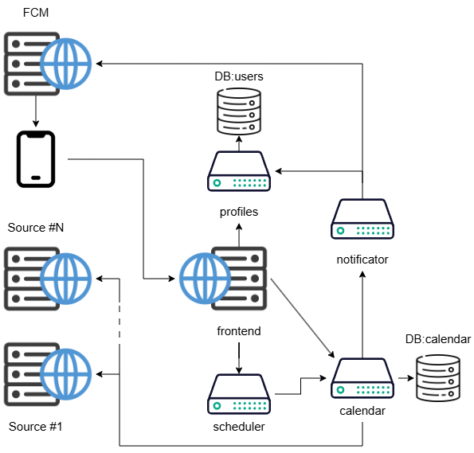

# Idea
C++ planner microservice app

When there are a lot of tasks it is difficult to keep an up-to-date schedule, especially if you don't know enough about your tasks (start time, place, duration, etc.).  When you need to reschedule existing tasks you often have to reorder them due to intersections, dependencies and limited resources. The same happens when you first build a schedule. The idea of this app is to automate such routine processes and make daily schedule management easier

# Solution

## Microservices
This web application is based on 6 services: 4 REST API, 1 frontend and 1 gateway (reverse proxy). 
### List
0. gateway - backend gate (reverse proxy)
1. frontend (port 5700) - static files + views
2. users (port 5701) - users database API. It also performs passwords hashing
3. calendar (port 5702) - calendars/events database API. It also updates calendars from external sources
4. scheduler (port 5703) - reschedule computer
5. notifier (port 5704) - service maintaining user notifications
### Graph


## Setup
### Drogon setup
There are some tips on top of [original Github Wiki](https://github.com/drogonframework/drogon/wiki/ENG-02-Installation "drogon Wiki ENG02 Installation") for drogon installation

#### Windows
On windows you can install drogon dependencies with Conan package manager. Conan can be installed via python pip:
```shell
python.exe -m pip install --upgrade pip 
pip -v
pip install conan
```
Then you should setup compiller profile:
```shell
conan profile detect
```
Conan will show you path to profile (probably `C:\Users\<USER>\.conan2\profiles`). You can edit it and check with:
```shell
conan profile show -pr default
```

Clone Drogon:
```shell
git clone https://github.com/drogonframework/drogon.git
cd drogon
git submodule update --init
```
Build it (with your own `<PATH_TO_INSTALL>`):
```shell
mkdir build
cd build
conan install .. -pr default --output-folder . --build=missing
cmake ..  -DCMAKE_BUILD_TYPE=Debug -DCMAKE_TOOLCHAIN_FILE="conan_toolchain.cmake" -DCMAKE_POLICY_DEFAULT_CMP0091=NEW -DCMAKE_INSTALL_PREFIX=<PATH_TO_INSTALL> -DLIBPQ_BATCH_MODE=OFF
cmake --build . --parallel --target install
```
### Project setup
Clone project with submodules:
```shell
git clone https://github.com/Richmick/planner.git
cd planner
git submodule update --init --recursive
```
Generate ssl certificates (openssl will request some data from stdin):
```shell
docker compose up -d
docker compose exec -w /app/.ssl planner openssl req -x509 -newkey rsa:4096 -keyout gateway.key -out gateway.cert.pem -days 365 -nodes
exit
```

#### Windows
```shell
cd build
conan install .. -pr default --output-folder . --build=missing
conan install ../conanfile_lib.txt -pr default --output-folder . --build=missing
```

## Usage
### Build
Configure cmake from `./build` (add `--preset=conan-default` for Conan):
```shell
cmake ..
```
Build from `./build`:
```shell
cmake --build . --parallel --target build-all
```

### Docker
To start docker session inside `/app/build` (use same build sequence inside):
```shell
docker compose exec planner sh
```
Run all services inside docker:
```shell
../start-builded.sh
```

> [!NOTE]
> Containers use ports in exclusive mode. Thus you cannot run docker and executable on host system at the same time